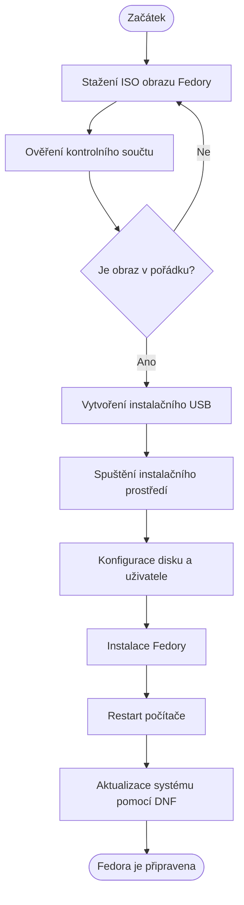

# Fedora Linux – svoboda, inovace a otevřený software


**Fedora Linux** je svobodný a open-source operační systém založený na linuxovém jádře. Je známý především moderními technologiemi, důrazem na bezpečnost, otevřenost a rychlé zavádění novinek. Projekt Fedora byl založen v roce 2003 a je podporován společností Red Hat společně s celosvětovou komunitou vývojářů.

> _„Freedom, Friends, Features, First“ – svoboda, přátelství, funkce a inovace._

## 1\. Co je Fedora Linux?

Fedora je moderní linuxová distribuce, která vychází z otevřeného vývoje a spolupráce komunity. Slouží jako technologická platforma pro nové linuxové technologie a zároveň jako plnohodnotný operační systém pro běžné uživatele, vývojáře i správce serverů.

Fedora je základem pro některé technologie a řešení využívané v podnikových systémech Red Hat Enterprise Linux (RHEL).

### 1.1 Hlavní cíle projektu

Mezi hlavní cíle Fedory patří:

- **Otevřenost:** systém je svobodný a jeho zdrojový kód je veřejně dostupný.
- **Bezpečnost:** využívá technologie jako SELinux a pravidelné bezpečnostní aktualizace.
- **Inovace:** rychle přináší nové verze softwaru a moderní technologie.
- **Komunita:** na vývoji spolupracují vývojáři a uživatelé z celého světa.
- **Flexibilita:** nabízí různé varianty pro pracovní stanice, servery, kontejnery i cloud.

_Fedora se snaží přinášet moderní technologie co nejrychleji, aniž by opomíjela stabilitu a bezpečnost._

## 2\. Architektura a komponenty

### 2.1 Linuxové jádro a uživatelský prostor

Základem Fedory je **Linuxové jádro**, které zajišťuje správu procesů, operační paměti, hardwarových zařízení, souborových systémů a síťové komunikace.

Nad jádrem běží uživatelský prostor, který obsahuje systémové nástroje, knihovny, služby a aplikace.

Výchozím grafickým prostředím varianty Fedora Workstation je **GNOME**. Uživatelé však mohou využívat také další prostředí, například KDE Plasma, Xfce nebo LXQt prostřednictvím různých edic a variant Fedory.

### 2.2 Bezpečnostní technologie

Fedora obsahuje několik důležitých technologií, které pomáhají chránit systém:

| Technologie | Účel |
| --- | --- |
| **SELinux** | Řízení přístupu k prostředkům systému pomocí bezpečnostních politik. |
| **firewalld** | Správa firewallu a síťových pravidel. |
| **Secure Boot** | Ověřování důvěryhodnosti zaváděcího procesu. |
| **dnf** | Správa softwarových balíčků a jejich závislostí. |
| **systemd** | Správa systémových služeb a spouštění systému. |

### 2.3 Správa balíčků

Fedora využívá správce balíčků **DNF**, který umožňuje instalovat, aktualizovat a odstraňovat software.

Balíčky jsou distribuovány především ve formátu RPM. DNF automaticky řeší závislosti mezi jednotlivými programy.

Příklad instalace textového editoru Vim:

bash

```bash
# Aktualizace systému
sudo dnf upgrade --refresh

# Instalace editoru Vim
sudo dnf install vim

# Zobrazení nainstalovaných balíčků
dnf list installed

# Vyhledání dostupného balíčku
dnf search firefox
```

_Díky DNF je správa softwaru přehledná a většina běžných úkonů se provádí pomocí několika příkazů._

## 3\. Praktická ukázka: kontrola systému

Následující Python skript vypíše základní informace o operačním systému, verzi jádra, architektuře procesoru a počtu dostupných CPU.

Python je zde pouze demonstrační nástroj. Fedora samotná obsahuje software vytvořený v mnoha programovacích jazycích, například C, C++, Rust nebo Python.

python

```python
import platform
import os

print("Operační systém:", platform.system())
print("Verze jádra:", platform.release())
print("Architektura:", platform.machine())
print("Počet CPU:", os.cpu_count())

# Zobrazení informací o distribuci
try:
    with open("/etc/os-release", "r") as file:
        print("\nInformace o distribuci:")
        print(file.read())
except FileNotFoundError:
    print("Soubor s informacemi o distribuci nebyl nalezen.")
```

### 3.1 Co skript provádí?

- Zjišťuje název operačního systému.
- Vypisuje verzi používaného jádra.
- Zjišťuje architekturu procesoru.
- Zobrazuje počet dostupných procesorových jednotek.
- Načítá informace o distribuci ze souboru `/etc/os-release`.

## 4\. Výhody a nevýhody Fedory

Fedora nabízí moderní prostředí a aktuální software. Přesto má stejně jako ostatní operační systémy určité nevýhody.

| Výhody | Nevýhody |
| --- | --- |
| Moderní technologie a software | Kratší životní cyklus jednotlivých vydání |
| Silná podpora bezpečnosti pomocí SELinux | Častější potřeba aktualizací |
| Velká a aktivní komunita | Některý proprietární software není dostupný v základních repozitářích |
| Výkonný správce balíčků DNF | Novější software může přinášet změny a problémy s kompatibilitou |
| Podpora moderního hardwaru | Některé ovladače vyžadují dodatečnou konfiguraci |
| Dostupnost desktopových i serverových variant | Pro úplné začátečníky může být správa systému náročnější |

_Fedora je vhodná zejména pro uživatele, kteří chtějí pracovat s aktuálními technologiemi Linuxu._

## 5\. Matematický model dostupnosti systému

Dostupnost operačního systému nebo služby lze vyjádřit jako poměr doby provozu k celkovému sledovanému času.

Procentuální dostupnost lze vypočítat pomocí následující rovnice:

$$
A = \frac{T_{provoz}}{T_{provoz} + T_{výpadek}} \times 100\,\%
$$

Kde:

- **A** je dostupnost systému v procentech.
- **T(provoz)** je doba, během které je systém funkční.
- **T(výpadek)** je doba, během které je systém nedostupný.

### 5.1 Praktický příklad

Pokud server s Fedorou běží 720 hodin a během sledovaného období má výpadek 3 hodiny, dostupnost bude:

$$
A = \frac{720}{720+3} \times 100
\approx 99{,}59\,\%
$$

_Pravidelné aktualizace, správná konfigurace a monitorování služeb pomáhají udržovat vysokou dostupnost systému._

## 6\. Typický postup instalace a konfigurace

Instalace Fedory probíhá pomocí grafického instalačního prostředí Anaconda. Uživatel si může vybrat disk, jazyk, uživatelský účet a další nastavení.

### 6.1 Postup instalace

Následující diagram znázorňuje zjednodušený postup instalace operačního systému Fedora Linux.

mermaid



### 6.2 První kroky po instalaci

Po dokončení instalace je vhodné provést několik základních úkonů:

1. Aktualizovat systém pomocí `sudo dnf upgrade --refresh`.
2. Zkontrolovat dostupné aktualizace zabezpečení.
3. Nastavit firewall pomocí `firewalld`.
4. Ověřit funkčnost hardwarových zařízení.
5. Nainstalovat potřebné aplikace a nástroje.

## 7\. Užitečné zdroje

Pro další studium Fedory je vhodné využít oficiální dokumentaci a komunitní zdroje:

- [Oficiální web Fedora](<https://fedoraproject.org/>) – informace o projektu, jednotlivých edicích a novinkách.
- [Dokumentace Fedora](<https://docs.fedoraproject.org/>) – návody k instalaci, konfiguraci a správě systému.
- [Fedora Packages](<https://packages.fedoraproject.org/>) – databáze dostupných softwarových balíčků.
- [Fedora Wiki](<https://fedoraproject.org/wiki/>) – informace o vývoji a fungování projektu.

## 8\. Osobní To-Do list

Následující seznam představuje úkoly, které lze splnit při seznamování s operačním systémem Fedora Linux.

- [x]Seznámit se s historií a filozofií projektu Fedora.
- [x]Prozkoumat architekturu a základní komponenty systému.
- [x]Vyzkoušet příkazy správce balíčků DNF.
- [ ]Nainstalovat Fedoru na fyzický počítač nebo virtuální stroj.
- [ ]Nakonfigurovat firewall pomocí firewalld.
- [ ]Prozkoumat bezpečnostní mechanismus SELinux.
- [ ]Vyzkoušet instalaci a odstraňování softwarových balíčků.
- [ ]Nastavit automatické aktualizace systému.

## Závěr

**Fedora Linux** představuje moderní, svobodný a otevřený operační systém, který klade důraz na inovace, bezpečnost a spolupráci komunity. Díky pravidelným aktualizacím, správci balíčků DNF, bezpečnostní technologii SELinux a podpoře moderního hardwaru je vhodnou volbou pro běžné uživatele, vývojáře i správce serverů.

Velkou předností Fedory je také její propojení s vývojem technologií, které se později využívají v dalších linuxových distribucích a podnikových řešeních.

_Fedora není jen operační systém – je to také prostředí pro poznávání Linuxu, experimentování a objevování nových technologií._
